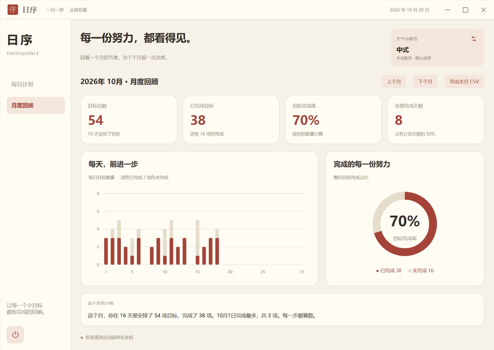
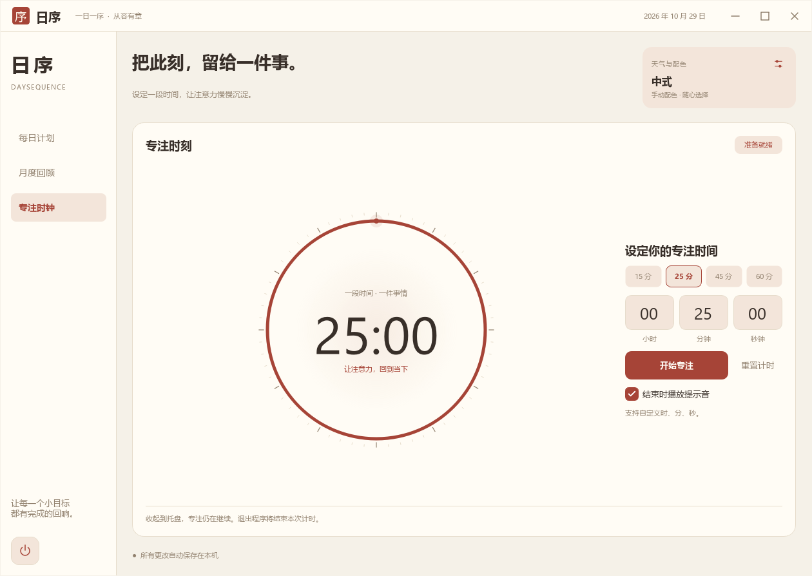
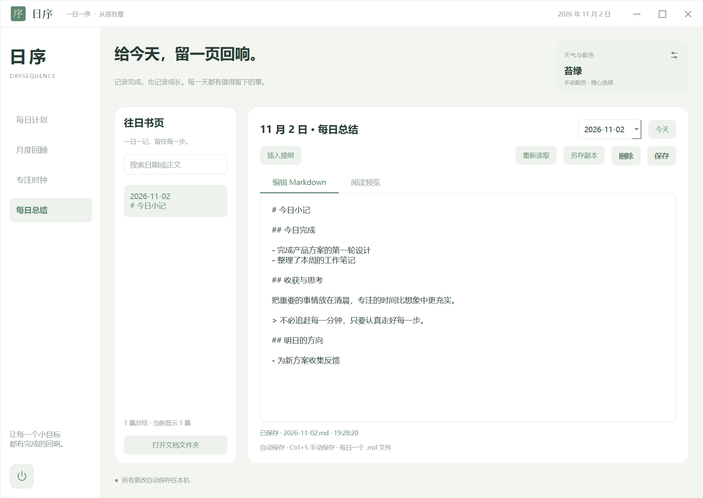

# 日序 · DaySequence

**规划今天，专注当下，记录成长。**

日序是一款面向 Windows 的本地每日计划软件。你可以提前安排目标、用专注倒计时推进工作、以图表回顾每个月，并用 Markdown 留下每日总结。

[下载最新版](https://github.com/walkeroliver/DaySequence/releases/latest) · [更新日志](CHANGELOG.md) · [报告问题](https://github.com/walkeroliver/DaySequence/issues) · [许可证](LICENSE)

- **运行平台**：Windows x64，已在 Windows 11 验证。
- **开发技术**：C++17 / Qt Widgets。
- **数据保存**：默认便携存储，支持自选数据目录。
- **开源许可**：GPL-3.0-only。

## 目录

- [界面预览](#界面预览)
- [主要功能](#主要功能)
- [下载安装](#下载安装)
- [使用指南](#使用指南)
- [数据管理与备份](#数据管理与备份)
- [从源码构建](#从源码构建)
- [项目结构](#项目结构)
- [反馈与贡献](#反馈与贡献)
- [许可证与第三方依赖](#许可证与第三方依赖)

## 界面预览

以下截图均使用示例数据。

| 每日计划 | 月度回顾 |
| :---: | :---: |
|  |  |
| **专注时钟** | **每日总结** |
|  |  |

## 主要功能

| 模块 | 功能 |
| --- | --- |
| 每日计划 | 按日期安排目标，支持添加、编辑、完成、删除、优先级、排序和搜索。 |
| 月度回顾 | 每日完成数量柱状图、整月完成比例环形图、月度统计与 CSV 导出。 |
| 专注时钟 | 自定义时分秒、常用时长预设、暂停与继续、自选完成铃声和持续响铃。 |
| 每日总结 | Markdown 编辑与预览、自动保存、历史搜索、补写往日记录和可恢复删除。 |
| 外观配色 | 中式、欧式、美式，以及苔绿、海盐蓝、雾紫、暖杏、夜色。 |
| 桌面体验 | 关闭到托盘、后台计时、单实例唤回、窗口位置记忆。 |
| 本地存储 | 数据保存在本机，支持自定义保存位置、迁移和计划备份。 |

当前公开版本不包含账号注册或云同步。天气自动换色暂未开放：尝试开启时显示居中提示，城市输入与天气请求保持停用，仍可手动切换配色。

## 下载安装

1. 前往 [Releases](https://github.com/walkeroliver/DaySequence/releases/latest)，下载 `DaySequence-<版本>-windows-x64.zip`。
2. 将压缩包**完整解压**到可写入的文件夹。
3. 双击解压目录中的 `DaySequence.exe`。

发布包已包含 Qt 与所需运行库，无需另行安装 Qt。请保留随附的 DLL、`plugins/` 和其他资源，不要只复制 EXE。源码包和 GitHub 自动生成的 Source code 压缩包供开发使用，不能直接运行。

程序目前未进行代码签名。其他 Windows 版本尚未单独验证。

### 升级已有版本

1. 通过托盘「退出日序」或左下角电源按钮完全退出程序。
2. 备份当前数据目录；如使用自定义位置，同时保留程序旁的 `storage.json`。
3. 将新版本完整解压到新文件夹，再迁入原有数据。默认便携模式复制原 `data/`；自定义位置保留 `storage.json` 及其指向的数据目录。
4. 启动新版本，确认计划、总结与偏好正常后再整理旧文件夹。

移动到其他电脑时，需一并迁移外部数据，并通过设置重新选择有效的保存位置。发布包不包含个人计划、偏好、总结、回收记录或自选音乐，仅包含三首预设铃声。

## 使用指南

### 每日计划与月度回顾

在日历中选择日期，输入目标并设置优先级。勾选目标记录完成情况；双击文字可编辑，手动排序时可调整顺序。月度回顾展示当前月份的统计与图表，并支持导出 CSV。

### 专注时钟与完成提醒

设置时、分、秒，或选择 15 / 25 / 45 / 60 分钟预设，然后开始计时。支持暂停、继续和重置；切换页面或收起到托盘后仍继续计时。

- **声音提醒**：决定完成后是否播放音频；音量为 0 时不播放。
- **持续响铃**：关闭时播放完整音频一遍，开启时循环至手动停止。
- **停止响铃**：可在完成提示条或托盘菜单操作，重置、再次开始和退出也会停止。
- **试听**：最多播放 8 秒，可随时停止。

内置清晨铃、柔和音、双叩铃，分别位于 `data/music/chime.wav`、`soft.wav`、`bell.wav`。点击「添加音乐…」可一次导入多首；也可将音频放入音乐文件夹，再点击「刷新列表」。导入时复制文件，移动原始音乐不会影响已导入曲目。同名同内容不重复导入，同名不同内容自动加序号。

支持 WAV、MP3、FLAC、M4A、OGG，单个文件上限 100 MB，实际播放能力取决于音频编码。文件丢失或解码失败时会显示原因并尝试默认铃声；无可用输出设备时会提示错误。退出程序后不恢复未完成计时或响铃状态。

### 每日总结

在侧栏打开「每日总结」，直接书写 Markdown，或点击「插入提纲」。每日计划中的「写这一天的总结」可打开所选日期；日期选择器支持补写历史记录，「今天」返回当天。

| 操作 | 行为 |
| --- | --- |
| 编辑与保存 | 停止输入约 1 秒后自动保存；点击「保存」或按 `Ctrl+S` 可立即保存。 |
| 离开当前内容 | 切换日期、页面、收起托盘、退出和迁移位置前再次保存。 |
| 查看往日总结 | 左侧「往日书页」按日期倒序展示，可搜索日期或正文，点击后继续编辑。 |
| 阅读预览 | 将 Markdown 显示为格式化内容；不加载图片，不跳转外部链接。 |
| 重新读取 | 读取磁盘上的版本；存在未保存编辑时需确认丢弃。 |
| 另存副本 | 将编辑内容保存到其他文件，当前文档仍保留原来的保存状态。 |
| 删除 | 需确认，已保存文件移入 `document/.trash/`，未保存编辑会丢弃。 |

总结使用标准 UTF-8 Markdown，命名为 `YYYY-MM-DD.md`，一日一文件，单个文件上限 2 MB。未使用总结、仅查看日期或只输入空白时，不创建新文件；已有文件清空后仍可保存为空文件。跨午夜保持正在编辑的日期，避免写入另一日。

保存失败或检测到外部修改时，会保留编辑内容并停止覆盖，阻止可能丢失编辑的页面切换与退出。请修复保存位置后重试，或先另存副本，再用「重新读取」处理当前文档。

恢复已删除总结：完全退出日序，将 `.trash/` 中的对应文件改回 `YYYY-MM-DD.md` 后放回 `document/`。如同日已有文件，请先备份并自行合并，避免覆盖。历史列表只识别有效日期命名的 `.md` 文件。

### 托盘与退出

- 右上角关闭：隐藏窗口，保留托盘并继续后台运行。
- 托盘「打开日序」：恢复窗口。
- 托盘「退出日序」或左下角电源按钮：保存后完全退出。
- 系统托盘不可用时，关闭窗口会直接退出。

如果总结尚未成功保存，程序会保留窗口和编辑内容，待处理后再退出。

## 数据管理与备份

### 默认目录

默认将数据保存在程序旁，文件按需创建：

```text
DaySequence/
├── DaySequence.exe
├── data/
│   ├── tasks.json          # 计划与完成状态
│   ├── settings.ini        # 配色、排序、铃声和窗口偏好
│   ├── music/              # 预设铃声与导入音乐
│   └── document/
│       ├── YYYY-MM-DD.md   # 每日总结
│       └── .trash/         # 已删除总结的回收目录
└── storage.json            # 自定义位置配置，仅在设置后生成
```

任务与偏好不存入注册表，不自动读取或导入 Daymark 旧数据。默认存储需要程序所在目录可写。

### 自定义保存位置

通过右上方天气与配色卡片的设置图标，打开「数据与备份」，点击「更改位置…」。保存设置并确认后，程序复制计划、偏好、音乐和总结（含回收目录），重启后使用新位置。源文件保留；目标存在同名不同内容或被另一个日序占用时，迁移会停止。

自定义目录记录在程序旁的 `storage.json`。此时音乐和总结分别存入所选目录的 `music/`、`document/`，仅复制程序文件夹不能带走外部数据。恢复默认便携位置，请通过设置重新选择程序旁的 `data/`。

迁移限制：音乐最多 2,000 个文件、总量 512 MB；总结目录最多 20,000 个文件、单文件 2 MB、总量 128 MB。超出时需先整理或单独备份，程序会明确提示。

### 备份范围

| 方式 | 包含内容 |
| --- | --- |
| 设置中的 JSON 计划备份 | 全部日期的目标与完成状态，**不含每日总结、音乐和偏好**。 |
| 月度 CSV 导出 | 所选月份的计划表格。 |
| 复制完整数据目录 | 计划、偏好、音乐、总结及回收记录。复制前应完全退出程序。 |

推荐定期备份整个当前数据目录。使用自定义位置时，同时保留 `storage.json`；每日总结也可单独复制整个 `document/` 文件夹备份。

需要重置时，先备份并完全退出程序：删除当前数据目录的 `tasks.json` 可清空计划，删除 `settings.ini` 可重置偏好。删除 `storage.json` 只恢复默认位置，不删除外部数据。

## 从源码构建

### 环境要求

| 依赖 | 要求 |
| --- | --- |
| Qt | 6.8 或更高版本，包含 Core、Widgets、Network、Multimedia；测试另需 Test。 |
| 编译器 | 支持 C++17，并与 Qt 套件匹配。当前发布环境为 MinGW 13.1 x64。 |
| CMake | 3.19 或更高版本。 |
| 构建工具 | Ninja。 |
| 发布参考环境 | Windows / Qt 6.8.3 / MinGW x64。 |

使用 Qt Creator 打开 `CMakeLists.txt` 并选择匹配的套件，或在配置好 Qt 与编译器的终端中执行：

```powershell
git clone https://github.com/walkeroliver/DaySequence.git
cd DaySequence
cmake -S . -B build/release -G Ninja -DCMAKE_BUILD_TYPE=Release -DCMAKE_PREFIX_PATH="你的 Qt 套件目录" -DBUILD_TESTING=ON
cmake --build build/release --parallel 4
ctest --test-dir build/release --output-on-failure
cmake --install build/release --prefix dist/DaySequence
```

测试覆盖计划、界面、数据迁移、进程退出和每日总结。部署后的可运行程序位于 `dist/DaySequence/`。

### 打包

```powershell
./scripts/package.ps1 -QtRoot "你的 Qt 套件目录" -CompilerRoot "对应的 MinGW 目录" -IncludeSource
```

脚本执行编译、测试、运行库部署、版本和数据检查，生成 `artifacts/` 下的 Windows ZIP、源码 ZIP 和 `SHA256SUMS.txt`。源码包取自 Git HEAD，使用 `-IncludeSource` 前需提交全部待发布修改。不要在部署暂存目录中运行测试数据，以免污染发布内容。

发布流程参见 [发布维护](docs/RELEASING.md)。

## 项目结构

```text
src/
├── app/              # 启动、单实例、数据目录和重启
├── core/             # 计划模型、排序、统计与倒计时
├── services/         # 总结存储、音乐库、音频提醒、数据迁移和天气数据处理
└── ui/
    ├── widgets/      # 日历、图表、任务列表、时钟、总结和选择控件
    └── components/   # 图标及公共界面组件
resources/            # SVG、ICO、预设音频和 Windows 版本资源
docs/                 # 架构、设计、截图和发布说明
tests/                # 自动化测试
scripts/              # 构建与打包脚本
```

- [架构说明](docs/ARCHITECTURE.md)
- [每日总结设计](docs/design-v2.5.0.md)
- [更新日志](CHANGELOG.md)
- [本版发布说明](RELEASE_NOTES.md)

生成隔离示例截图可运行 `DaySequence.exe --preview <输出目录>`，不会读取真实用户计划。

## 反馈与贡献

欢迎通过 [GitHub Issues](https://github.com/walkeroliver/DaySequence/issues) 报告问题或提出建议。问题报告请提供软件版本、Windows 版本、复现步骤、预期行为和实际表现；可附截图或错误日志，请先移除个人数据。

提交代码前请完成相关测试，并说明改动目的及验证结果。涉及数据保存、迁移或退出行为的变更，应覆盖相应的回归场景。

## 许可证与第三方依赖

Copyright (C) 2026 WalkerOliver。项目源码采用 **GPL-3.0-only**，详见 [LICENSE](LICENSE) 与 [NOTICE](NOTICE)。

Qt、MinGW 和 FFmpeg 等依赖遵循各自的许可证。发布包保留相应声明与许可证文件，详见 [第三方依赖说明](THIRD_PARTY_NOTICES.md) 和 [licenses/](licenses/)。
