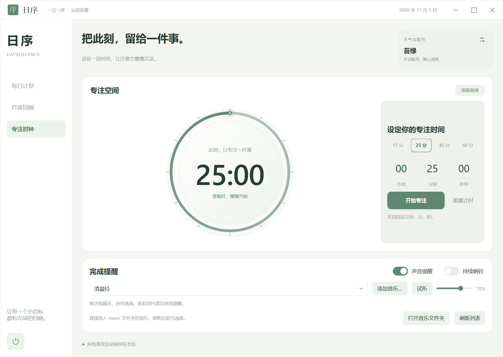

# 日序 · DaySequence

一款适用于 Windows 的简约每日计划软件：提前安排目标，记录每天的完成情况，用图表回顾整个月。

[下载 Windows 版](https://github.com/walkeroliver/DaySequence/releases/latest) · [提交问题](https://github.com/walkeroliver/DaySequence/issues) · [GPL-3.0 许可证](LICENSE)

## 界面




截图使用示例数据。

## 功能

- 每日计划：按日期添加、编辑、完成目标，支持优先级、排序与搜索。
- 专注时钟：自定义时、分、秒，15/25/45/60 分钟预设，开始、暂停、继续与重置。渐变表盘适配主题；完成后播放选定铃声，可选持续响铃，支持界面和托盘停止提醒。
- 月度回顾：每日完成数量柱状图、整月完成比例环形图、统计与 CSV 导出。
- 主题：中式、欧式、美式，以及苔绿、海盐蓝、雾紫、暖杏、夜色。
- 天气自动换色暂未开放：尝试开启时显示居中提示，当前使用手动配色，不发送天气请求。
- 本地记录：默认便携存储，也可自选保存位置；自动保存并支持全部计划备份。
- 桌面体验：系统托盘、单实例唤回、窗口位置记忆和小窗口滚动。
- 统一下拉菜单：主题配色、清晰选中标识、方向键/回车/Esc 操作，收起时滚轮不会误改选项。

## 下载与运行

1. 在 [Releases](https://github.com/walkeroliver/DaySequence/releases) 下载 DaySequence-2.4.0-windows-x64.zip。
2. 完整解压 ZIP，双击文件夹中的 DaySequence.exe。
3. 保留随附的 DLL 和 plugins 文件夹；不需要另行安装 Qt。

目标平台为 Windows x64。本次发布在 Windows 11 验证，其他 Windows 版本尚未单独验证。程序尚未进行代码签名。

右上角图标打开外观、天气、数据与备份设置。右上角关闭会隐藏窗口并保留托盘，继续后台运行；托盘「打开日序」可恢复窗口。托盘「退出日序」和左下角电源按钮会完全结束程序，即使窗口已经隐藏也不会残留进程。系统托盘不可用时，关闭窗口会直接退出。

## 数据与隐私

默认使用便携模式，任务和偏好保存在程序旁的 data 文件夹：

- tasks.json：计划与完成状态。
- settings.ini：主题、排序、天气、专注铃声及窗口偏好。
- music/：三种预设铃声与用户添加的音乐，移动原音频文件不影响使用。

在设置的「数据与备份」页点击「更改位置…」，可以选择其他保存文件夹。点击「保存设置」并确认后，程序复制当前任务与偏好，重新启动后使用新位置。原文件保留；目标文件夹已有不同数据或正被另一个日序使用时停止迁移，避免覆盖。

自定义位置记录在程序旁的 storage.json，只含保存路径。选择自定义位置后，备份、移动电脑或升级时请同时保留这个文件和它指向的数据文件夹；仅复制程序不能带走外部数据。若恢复为程序旁的 data，请再次通过设置选择该目录。程序目录需要可写权限以保存位置配置。

完全退出后，可备份并删除**当前保存位置**的 tasks.json 清空任务；删除该位置的 settings.ini 可重置偏好。删除 storage.json 只恢复默认保存位置，不删除外部数据。发布 ZIP 和源码包不含个人数据或保存位置配置。

天气自动换色当前暂不可用，城市输入和天气请求已停用；已有开启偏好会恢复为手动配色。尝试开启时显示自动消失的居中提示，不弹对话框。程序不包含账号注册或云同步。

已删除 Daymark 旧数据读取与导入功能，不再读取或写入旧版注册表偏好。如需保留此前便携版的当前格式记录，请完全退出后，将 data/plans-v2.json 手动改名为 data/tasks.json；程序不会自动迁移旧文件。

## 从源码构建

需要 Qt 6.8+（Core、Widgets、Network、Multimedia，测试另需 Test）、CMake 3.19+、Ninja 和匹配的 C++17 编译器。发布包使用 Qt 6.8.3 / MinGW 13.1 x64。

使用 Qt Creator 打开 CMakeLists.txt，选择匹配的 Qt 套件即可。也可在 Qt 构建环境中运行：

```powershell
cmake -S . -B build/release -G Ninja -DCMAKE_BUILD_TYPE=Release -DCMAKE_PREFIX_PATH="你的 Qt 套件目录"
cmake --build build/release --parallel 4
ctest --test-dir build/release --output-on-failure
cmake --install build/release --prefix dist/DaySequence
```

打包便携版与源码包：

```powershell
./scripts/package.ps1 -QtRoot "你的 Qt 套件目录" -CompilerRoot "对应的 MinGW 目录" -IncludeSource
```

脚本先编译和测试，再生成 artifacts/ 下的 ZIP 和 SHA256SUMS.txt。源码包取自当前 Git HEAD，请先提交要发布的源码。

## 项目结构

```text
src/
  app/          启动、单实例、数据位置解析与重启
  core/         任务、排序、月度统计与文件校验
  services/     保存位置迁移、天气数据处理
  ui/           窗口、主题、设置与天气交互
    widgets/    日历、图表、任务列表、统一下拉选择控件
    components/ 图标和公共界面组件
resources/      SVG、Windows ICO 与版本资源
tests/          任务、界面、存储迁移测试
scripts/        构建、测试、部署与打包
```

架构边界与存储流程见 [架构说明](docs/ARCHITECTURE.md)。Windows EXE 内嵌多尺寸图标和产品版本信息。

开发预览：DaySequence.exe --preview <输出目录>。使用隔离的示例数据和设置，不读取真实计划。

## 开源与依赖

Copyright (C) 2026 WalkerOliver。项目源码采用 **GPL-3.0-only**，详见 [LICENSE](LICENSE)。Qt 与 MinGW 运行库保留其原有许可证，详见 [第三方说明](THIRD_PARTY_NOTICES.md) 和 licenses/。

天气服务：[Open-Meteo](https://open-meteo.com/)。发布维护说明见 [docs/RELEASING.md](docs/RELEASING.md)。
## 专注完成提醒（2.4）

「声音提醒」控制是否播放；「持续响铃」关闭时播放完整音频一遍，开启时循环到手动停止。可在完成提示条或托盘菜单点击「停止响铃」，重置、再来一次及退出程序也会停止。切换页面或关闭到托盘不打断计时与提醒；退出后不恢复未完成会话或铃声。

下拉选择三种内置铃声，或点击「选择音频…」导入 WAV、MP3、FLAC、M4A、OGG 文件，最大 100 MB，实际能否播放取决于音频编码与可用后端。导入副本存于当前数据目录 music/，更改保存位置时随当前偏好复制。发布 ZIP 仅含三种原始预设音频，不含用户音乐。试听只播放一遍，最长 8 秒，随时可停止。音量为 0 时不播放。

文件丢失或解码失败会显示原因并尝试默认清晨铃；无输出设备或默认铃声也无法播放时显示错误，不使用系统提示音冒充播放成功。

### 音乐文件夹

默认在程序文件夹下的 data/music：chime.wav（清晨铃）、soft.wav（柔和音）、bell.wav（双叩铃）。发布包直接包含这三首原始预设；旧程序升级或使用自定义数据位置时会补齐缺少的预设，不覆盖已有同名文件。

「添加音乐…」支持一次选择多首，保留之前的曲目；内容相同的同名文件不重复导入，内容不同时自动添加序号。也可点击「打开音乐文件夹」，直接放入自己喜欢的音乐，再点击「刷新列表」。支持 WAV、MP3、FLAC、M4A、OGG，单个文件最多 100 MB，格式可播放性仍取决于具体编码。下拉框可在所有曲目间切换，试听最多 8 秒，持续响铃模式会完整循环所选音乐。

若已在设置中更改数据位置，则音乐库位于所选数据文件夹的 music 子目录，迁移时连同全部受支持音乐复制，原文件保留。仅迁移当前选中歌曲的旧行为已取消；迁移音乐总量限制为 512 MB、最多 2000 个文件，超出时明确提示，不会悄悄漏复制。
